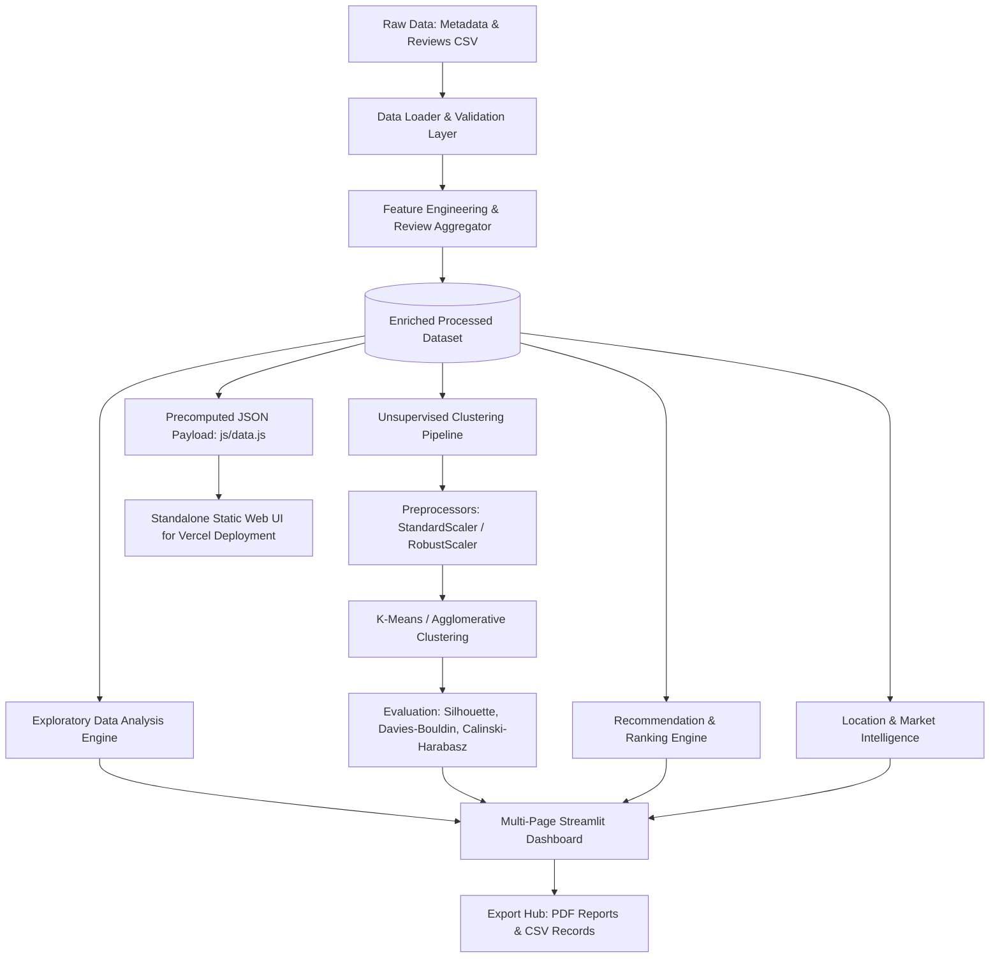

# 🍽️ Zomato Restaurant Intelligence Platform
### Cost Clustering, Market Analytics & Smart Recommendations

[](https://python.org)
[](https://streamlit.io)
[](https://scikit-learn.org)
[](https://plotly.com)
[](https://pytest.org)
[](https://vercel.com)
[](https://opensource.org/licenses/MIT)

> **Developed by [Priya Sharma](https://github.com/sharmapriya18504-dotcom)**  
> *B.Tech Student | Aspiring Data Scientist & Machine Learning Engineer*

An end-to-end Data Science & Unsupervised Machine Learning platform analyzing and segmenting 105+ restaurants across Hyderabad listed on Zomato. The application groups dining places into intelligent pricing tiers (**Budget-Friendly**, **Mid-Range Dining**, and **Premium & Luxury**) using K-Means and Agglomerative clustering, validated by mathematical Silhouette scores, and powers a transparent multi-criteria recommendation engine.

---

## 🏛️ System Architecture



---

## 🌟 Key Features & Capabilities

1. **📊 Executive Overview Dashboard**: Real-time market metrics, KPI cards, core distributions, and automated factual takeaways.
2. **📈 Exploratory Data Analysis (EDA)**: Interactive Plotly distributions, IQR outlier diagnostics, culinary rankings, and numerical feature correlation heatmaps.
3. **🤖 Advanced Restaurant Clustering**:
   - Algorithms: **K-Means Clustering** & **Agglomerative Hierarchical Clustering**.
   - Tunable $K \in [2, 7]$ with ordered centroids ensuring ascending cost interpretation.
   - Dynamic cluster profile tables and boxplot cost segmentation.
4. **🧪 Model Evaluation & Benchmarking**:
   - Interactive **Elbow Curve** (Inertia vs $K$).
   - **Silhouette Score** (**0.590** at $K=3$), **Davies–Bouldin Index** (**0.536**), and **Calinski–Harabasz Index** (**243.8**).
5. **🔍 Smart Recommendation Engine**:
   - Transparent composite scoring (Rating 40%, Reviews 25%, Budget 20%, Cuisine 15%).
   - Human-readable recommendation explanations.
   - **Graceful Filter Relaxation**: Automatically expands search bounds when no exact matches exist.
6. **⚔️ Competitor & Peer Analysis**: Benchmarks individual restaurants against neighborhood and category peers with delta indicators.
7. **🗺️ Location & Market Geography**: Locality-level dining density, market concentration, and geographic fallbacks.
8. **📑 Reports & Data Exports**: Generates executive PDF reports via ReportLab and downloadable CSV datasets.
9. **🌐 Dual Deployment Ready**:
   - **Streamlit Multi-Page Platform** (`app.py` & `pages/`) for local and Streamlit Cloud.
   - **Standalone Web Application** (`index.html`, `css/`, `js/`, `vercel.json`) for instant 1-click **Vercel** hosting!

---

## 🗂️ Project Structure

```bash
zomato_project/
├── app.py                           # Main Streamlit platform portal
├── index.html                       # Standalone web UI for Vercel deployment
├── vercel.json                      # Vercel deployment & caching configuration
├── requirements.txt                 # Project dependencies
├── README.md                        # Project documentation & guide
├── .gitignore                       # Git ignore rules
├── .env.example                     # Environment template
│
├── pages/                           # Streamlit Multi-Page Dashboards
│   ├── 1_📊_Executive_Overview.py
│   ├── 2_📈_Exploratory_Analysis.py
│   ├── 3_🤖_Cost_Clustering.py
│   ├── 4_🗺️_Location_Intelligence.py
│   ├── 5_🔍_Restaurant_Finder.py
│   ├── 6_⚔️_Competitor_Analysis.py
│   ├── 7_🧪_Model_Evaluation.py
│   └── 8_📑_Reports_Explorer.py
│
├── src/                             # Core Python Computation Modules
│   ├── __init__.py
│   ├── config.py                    # Paths, column aliases, theme tokens
│   ├── data_loader.py               # Safe CSV reading, encoding fallbacks, demo mode
│   ├── validation.py                # Schema validation & column mapping layer
│   ├── preprocessing.py             # Feature scaling, imputation, outlier checks
│   ├── feature_engineering.py       # Review aggregation & location extraction
│   ├── eda.py                       # KPI calculations & automated insights
│   ├── clustering.py                # K-Means, Agglomerative, centroid ordering
│   ├── evaluation.py                # Silhouette, Davies-Bouldin, Elbow curve
│   ├── recommendations.py           # Multi-criteria scoring & filter relaxation
│   ├── location_analysis.py         # Area density & tier distributions
│   └── reporting.py                 # ReportLab PDF generator & CSV exports
│
├── components/                      # Reusable UI Components
│   ├── __init__.py
│   ├── sidebar_filters.py           # Dataset selector, upload widget & ML controls
│   ├── kpi_cards.py                 # Styled glassmorphism metric cards
│   ├── charts.py                    # Interactive Plotly chart builders
│   └── restaurant_cards.py          # Restaurant listings cards with badges
│
├── data/
│   ├── raw/                         # Raw metadata and reviews CSV files
│   └── processed/                   # Enriched master dataset (zomato_enriched.csv)
│
├── css/                             # Custom Web UI stylesheet
│   └── style.css
├── js/                              # Standalone Web UI application logic & precomputed data
│   ├── app.js
│   └── data.js
│
├── tests/                           # Pytest Automated Test Suite (17 Tests)
│   ├── test_data_validation.py
│   ├── test_preprocessing.py
│   ├── test_clustering.py
│   └── test_recommendations.py
│
└── docs/                            # In-Depth Documentation
    ├── architecture.md
    ├── data_dictionary.md
    └── model_card.md
```

---

## 💻 Local Setup & Installation

### 1. Clone the repository
```bash
git clone https://github.com/sharmapriya18504-dotcom/zomato_project.git
cd zomato_project
```

### 2. Create and activate a Virtual Environment
```powershell
# Windows PowerShell
python -m venv venv
.\venv\Scripts\Activate.ps1
```

### 3. Install Dependencies
```bash
pip install -r requirements.txt
```

### 4. Run the Streamlit Application
```bash
streamlit run app.py
```
Open `http://localhost:8501` in your browser.

### 5. Run the Automated Test Suite
```bash
pytest tests/ -v
```

---

## 🚀 How to Deploy on Vercel (1-Click)

1. Push your latest code to GitHub:
   ```bash
   git add .
   git commit -m "feat: complete advanced restaurant intelligence platform"
   git push origin main
   ```
2. Log into [vercel.com](https://vercel.com) with your GitHub account.
3. Click **"Add New Project"** -> **"Import"** `zomato_project`.
4. Leave settings as default (Root directory `./`, Framework: Other).
5. Click **"Deploy"**! Your interactive platform will be live in seconds with free SSL.

---

## 📊 Machine Learning Model Benchmarks

| Algorithm | Clusters ($K$) | Silhouette Score (↑) | Davies–Bouldin (↓) | Calinski–Harabasz (↑) | Model Notes |
| :--- | :---: | :---: | :---: | :---: | :--- |
| **K-Means** | **3** | **0.590** | **0.536** | **243.8** | **Recommended Elbow Point** |
| **K-Means** | 4 | 0.608 | 0.502 | 344.2 | Subdivides mid-range tier |
| **Agglomerative (Ward)** | 3 | 0.590 | 0.536 | 243.8 | Matches K-Means partitions |
| **Agglomerative (Average)**| 3 | 0.521 | 0.578 | 186.4 | Hierarchical average linkage |

---

## 👩‍💻 Author

**Priya Sharma**  
- B.Tech Student | Aspiring Data Scientist & Machine Learning Engineer  
- GitHub: [@sharmapriya18504-dotcom](https://github.com/sharmapriya18504-dotcom)  
- Email: sharmapriya18504@gmail.com  
