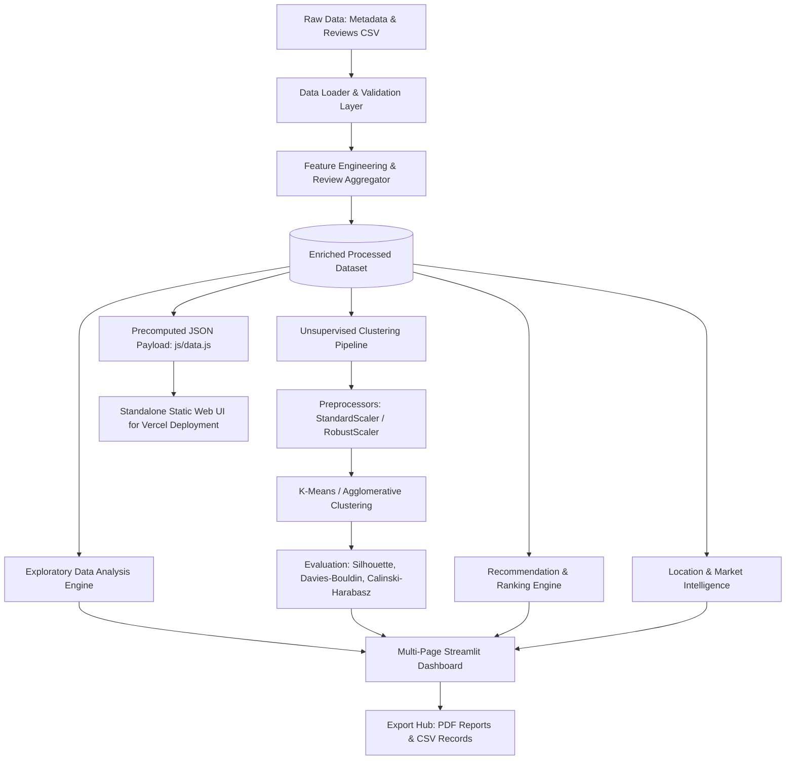

# Architecture & System Design

## 🏛️ High-Level System Architecture

The **Zomato Restaurant Intelligence Platform** follows a clean, modular architecture separating UI presentation, business logic, machine learning pipelines, and data storage.

---

## 📦 Directory Components

- **`app.py`**: Central Streamlit application entrypoint with dark glassmorphism styling and navigation hub.
- **`pages/`**: 8 multi-page dashboards:
  1. `1_📊_Executive_Overview.py`: Executive market summary, core KPIs, and automated insights.
  2. `2_📈_Exploratory_Analysis.py`: Distribution histograms, IQR outlier diagnostics, and correlation heatmaps.
  3. `3_🤖_Cost_Clustering.py`: Tunable K-Means & Agglomerative clustering with dynamic segment profiling.
  4. `4_🗺️_Location_Intelligence.py`: Locality-level dining density and pricing tier shares.
  5. `5_🔍_Restaurant_Finder.py`: Multi-criteria recommendation engine with filter relaxation.
  6. `6_⚔️_Competitor_Analysis.py`: Benchmarking individual restaurants against local peers.
  7. `7_🧪_Model_Evaluation.py`: Elbow curve analysis and mathematical clustering validation.
  8. `8_📑_Reports_Explorer.py`: Executive ReportLab PDF generation and CSV exports.
- **`src/`**: Pure Python computational core:
  - `config.py`: Directory paths, canonical column aliases, and model defaults.
  - `validation.py`: Schema validation and dynamic column mapping.
  - `data_loader.py`: Safe CSV loading with encoding fallbacks and demo generator.
  - `preprocessing.py`: Cost/rating sanitization and scikit-learn transformers.
  - `feature_engineering.py`: Review aggregation and location parsing.
  - `eda.py`: Statistical metrics and automated insight generation.
  - `clustering.py`: Clustering models and centroid ordering.
  - `evaluation.py`: Unsupervised metric evaluation and elbow curve iteration.
  - `recommendations.py`: Composite recommendation scoring and relaxation logic.
  - `location_analysis.py`: Market density and locality statistics.
  - `reporting.py`: PDF report generation and CSV serialization.
- **`components/`**: Reusable Streamlit UI components (`sidebar_filters.py`, `kpi_cards.py`, `charts.py`, `restaurant_cards.py`).
- **`tests/`**: Comprehensive Pytest automated test suite covering all core modules.
- **`index.html` & `vercel.json`**: Standalone web UI optimized for zero-config Vercel hosting.
